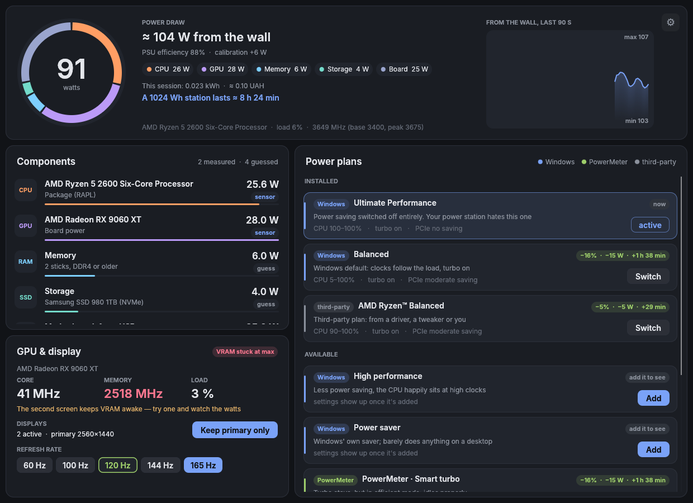

# PowerMeter

A small Windows app that shows how much power your PC draws, per component and from the wall, how long a power station would keep it running, and how much each power plan could save.



## About this project

Full disclosure: this was written with a lot of help from AI. It started as a C# app, worked fine, and was then rewritten in Rust anyway, because apparently that's how these things go.

Since the app runs as administrator and loads a kernel driver, I didn't want it to be a black box. Everything it does to your system is listed in [the table below](#what-it-touches-on-your-system), along with how to undo it.

## Features

- **Power per component.** CPU package power comes from the RAPL energy counter, GPU board power from the driver. Memory, disks and the motherboard have no power sensors, so they're estimated and marked as "guess".
- **Power from the wall.** The DC total divided by your PSU efficiency. If you have a wall meter or a power station with a display, you can calibrate against it: the difference shows up as a separate "Calibration offset" row.
- **Power station runtime.** Enter the capacity in Wh and see how long it would last at the current draw, and how much time each power plan would add or take away.
- **Power plans.** Standard Windows plans, third-party ones, and four presets from PowerMeter, from "turbo, but efficient" to a CPU capped at 50%. Each shows an estimated change in %, watts and runtime. Adding, switching and deleting take one click.
- **Idle GPU check.** Shows the VRAM clock and points out when video memory stays at full speed while idle, which can waste 10–20 W. A second monitor or a high refresh rate is the usual cause, and both can be changed right there.
- **Power plan unlock.** Some "optimizer" tools lock the active plan with a group policy. PowerMeter detects this and can remove the lock.
- **Other bits.** Session energy counter (kWh and cost), tray icon with the current draw, settings stored next to the exe.

## Download

1. Download `PowerMeter-portable.exe` from [Releases](../../releases).
2. Run it. No installation or runtime needed.
3. It asks for administrator rights, which are needed to read CPU power and to manage power plans.
4. The exe is not code-signed, so SmartScreen may show a warning: **More info → Run anyway**.

Requires Windows 10 or 11, 64-bit.

## First run

- **PawnIO driver.** Reading CPU power requires the [PawnIO](https://pawnio.eu) driver. If it's missing, a banner offers to download and run the official installer from [its GitHub](https://github.com/namazso/PawnIO.Setup). You can also install it yourself.
- **Calibration.** Gear icon → *Calibrate against a wall meter*. Enter what your meter shows and press Fit. If monitors or anything else share the same outlet, subtract them first (see [below](#what-it-cant-see)), otherwise their power gets attributed to the PC.
- **Power station.** In the same dialog, enter the capacity in Wh. For reference: EcoFlow River 2 is 256, River 2 Pro 768, Delta 2 1024, Delta 2 Max 2048.

## How the numbers are calculated

| What | Source | Accuracy |
|---|---|---|
| CPU | RAPL energy counter via PawnIO: MSR `0x611` on Intel, `0xC001029B` on AMD Zen | measured |
| GPU | NVML on NVIDIA; ADL PMLog on AMD (board power on RDNA3 and newer, ASIC power on older cards) | measured |
| Memory | number of sticks × 3 W (DDR4) or 4 W (DDR5) | estimate |
| Disks | NVMe 4 W, SATA SSD 2.5 W, HDD 6 W | estimate |
| Motherboard, fans, USB | 25 W | rough estimate, which is what calibration is for |
| From the wall | DC total ÷ PSU efficiency | depends on the efficiency you set |
| Plan forecast | a plan only changes the CPU frequency range; dynamic power ∝ f^2.5; near idle, the minimum processor state decides where the CPU settles; PCIe ASPM ≈ 1 W per level | rough estimate, worth checking with a meter |
| Station runtime | capacity × inverter efficiency ÷ power from the wall | doesn't account for battery wear |

## What it can't see

PowerMeter only knows about what's inside the PC case. Monitors, speakers, a router or anything else plugged into the same outlet or power station is invisible to it, because none of that goes through the PC's power supply and there are no sensors for it.

So if your meter shows noticeably more than "from the wall", that's usually why. A typical 24" monitor draws 12–25 W, a larger or high-refresh one more. The easiest way to find out exactly is to unplug a monitor's power cable for a few seconds and watch how much the meter drops.

The same applies to the station runtime estimate: it covers the PC only.

## What it touches on your system

Reading happens continuously. Anything that **changes** a setting happens only when you press a button.

| Action | How | When | How to undo |
|---|---|---|---|
| Read CPU power | Opens `\\?\GLOBALROOT\Device\PawnIO`, loads the signed module `AMDFamily17.bin` or `IntelMSR.bin`, calls `ioctl_read_msr` for `0x606`/`0x611` (Intel) or `0xC0010299`/`0xC001029B` (AMD) | every second, read-only | — |
| CPU load and clock | PDH counters `\Processor Information(_Total)\% Processor Utility` and `% Processor Performance`; CPU name and base clock from `HKLM\HARDWARE\DESCRIPTION\System\CentralProcessor\0` | every second, read-only | — |
| GPU | `nvml.dll`: `nvmlDeviceGetPowerUsage`, `nvmlDeviceGetClockInfo`, `nvmlDeviceGetUtilizationRates`; `atiadlxx.dll`: `ADL2_New_QueryPMLogData_Get` | every second, read-only | — |
| RAM and disks | WMI: `Win32_PhysicalMemory`, `MSFT_PhysicalDisk` | once at startup | — |
| Read power plans | `PowerEnumerate`, `PowerGetActiveScheme`, `PowerReadFriendlyName`, `PowerReadACValueIndex` / `PowerReadDCValueIndex` | every second | — |
| Switch plan | `PowerSetActiveScheme` | **Switch** | switch back |
| Add a PowerMeter plan | `powercfg -duplicatescheme <Balanced> <plan GUID>`, then `PowerWriteFriendlyName`, `PowerWriteDescription`, `PowerWriteACValueIndex` / `PowerWriteDCValueIndex` for max/min processor state, boost mode, EPP, PCIe ASPM, USB selective suspend | **Add** | **delete**, or `powercfg -delete <GUID>` |
| Restore a Windows plan | `powercfg -duplicatescheme <GUID> <GUID>` | **Add** on a Windows plan | `powercfg -delete <GUID>` |
| Remove the plan lock | Deletes `ActivePowerScheme` from `HKLM\SOFTWARE\Policies\Microsoft\Power\PowerSettings`, runs `gpupdate /target:computer /force` | **Unlock** (shown only when the lock exists) | `reg add "HKLM\SOFTWARE\Policies\Microsoft\Power\PowerSettings" /v ActivePowerScheme /t REG_SZ /d <GUID>` |
| Refresh rate | `EnumDisplaySettingsW` to read, `ChangeDisplaySettingsExW` with `CDS_UPDATEREGISTRY` to change | a refresh rate button | choose another rate here or in Windows settings |
| Primary display only | `ChangeDisplaySettingsExW` detaches non-primary displays | **Keep primary only** | **Bring all back** (`SetDisplayConfig` with `SDC_TOPOLOGY_EXTEND`) or Win+P |
| Install PawnIO | `URLDownloadToFileW` from `github.com/namazso/PawnIO.Setup/releases/latest/download/PawnIO_setup.exe` to `%TEMP%`, runs it with `-install`, then deletes it | **Download & install** | Settings → Apps → PawnIO → Uninstall |
| Tray icon | `Shell_NotifyIconW` from a hidden message-only window | while running | quit the app |
| Single instance | named mutex `Local\PowerMeter.SingleInstance` | while running | — |
| Settings | `PowerMeter.json` next to the exe, or in `%APPDATA%\PowerMeter\` if that folder is read-only | when you press **Save** | delete the file |
| Dark title bar | `DwmSetWindowAttribute` | at startup | — |

**Network:** the only network request is the PawnIO download, and only when you press that button. No telemetry, analytics or update checks.

PowerMeter plans use the GUIDs `b7e3a1c0-5d2f-4e8a-9c61-0f4d2a7e5b01` to `…5b04`, so they're easy to find and remove.

## Building from source

On Windows, with [Rust](https://rustup.rs) and the Visual Studio C++ Build Tools installed:

```powershell
git clone https://github.com/w1cee/PowerMeter
cd PowerMeter
cargo build --release
```

The result is `target\release\PowerMeter.exe`. Release builds are made by GitHub Actions ([`release.yml`](.github/workflows/release.yml)) from `v*` tags.

On Linux and macOS, `cargo run` starts a demo mode with simulated hardware. It's only there for working on the UI (the screenshot above was taken in it) and doesn't show anything about the actual machine.

## FAQ

**Why Rust?**
The C# version worked fine. There isn't a better reason.

**Is it safe?**
Like other hardware monitors, it runs as administrator and uses a kernel driver. Everything it does is listed above.

**How accurate is it?**
CPU and GPU power are measured. The rest is estimated and can be calibrated against a wall meter. Plan forecasts are approximate, so a real meter is always the better judge.

**My wall meter shows more than PowerMeter. Why?**
Most likely your monitors are on the same outlet. See [What it can't see](#what-it-cant-see).

**Why are memory, disks and the motherboard only estimated?**
They have no power sensors. Other monitoring tools don't measure them either; the exceptions are DDR5 memory, which has a power management chip on each stick, and power supplies with built-in telemetry, neither of which PowerMeter supports yet.

**Does it work on Linux?**
It builds there, but only in demo mode with simulated data.

**Intel Arc or integrated graphics?**
Integrated graphics are already included in the CPU package power. Discrete Intel Arc cards aren't supported yet.

## Credits

- [LibreHardwareMonitor](https://github.com/LibreHardwareMonitor/LibreHardwareMonitor): used as a reference for working with PawnIO and ADL. No code from it is included.
- [PawnIO](https://github.com/namazso/PawnIO.Setup) by namazso: the driver. The two module binaries in `assets/pawnio/` are the official signed builds, unmodified, licensed under LGPL-2.1-or-later; their source is in [PawnIO.Modules](https://github.com/namazso/PawnIO.Modules).
- [egui / eframe](https://github.com/emilk/egui): the UI.

## License

[MIT](LICENSE). The PawnIO module binaries keep their own license (LGPL-2.1-or-later).
